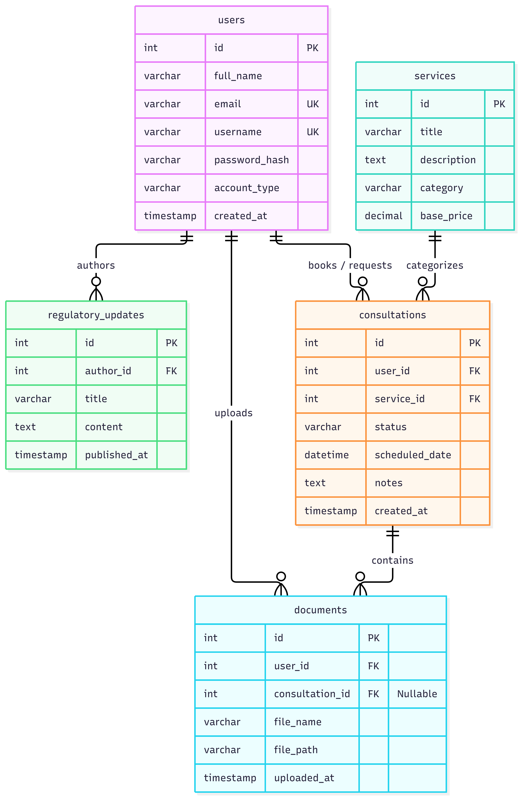

# Cybersecurity-Services-Website

# CyberGuard Legal: Cybersecurity Services Website

## Project Description

**CyberGuard Legal** is a cybersecurity services website designed to bridge the gap between enterprise clients and security professionals. The website allows organizations to book penetration testing assessments, track active vulnerability reports, monitor real-time security alerts, and manage incident response tickets. Security analysts can review system scans, update remediation statuses, and interact directly with clients through a secure ticketing system.

---

## Entities and Their Relationships



---

## Roles

The platform implements Role-Based Access Control (RBAC) with three primary tiers:

| Role | Description |
| :--- | :--- |
| **Admin** | The website admin |
| **Analyst** | Performs assessments, logs vulnerabilities, and updates reports |
| **Client** | Books services, views vulnerability findings, and downloads reports |

---

## External API and Supported Features (Coming soon)

* **API Name**: NIST National Vulnerability Database (NVD) API / CVE API
* **Feature Supported**: Automatically fetches real-time Common Vulnerabilities and Exposures (CVE) descriptions, severity scores (CVSS), and patch references when an analyst inputs a vulnerability identifier into a report.

---

## Instructions for Running the Project Locally

WIP

```

The application will be accessible at `http://localhost:5000`.

---

## API Documentation (Swagger)

WIP

---

<!--
## Deployed Application

WIP
